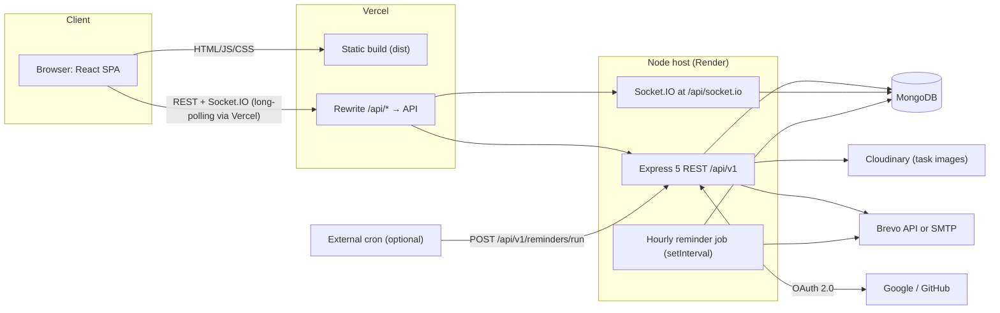
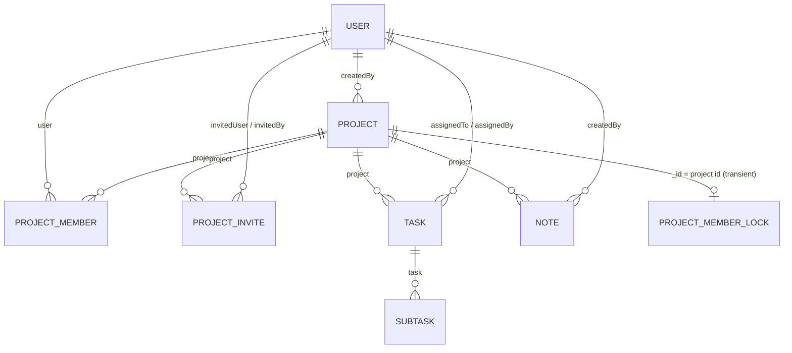

# CAMP: Full Project Context

> **Purpose of this document:** a complete, self-contained description of the existing CAMP codebase (architecture, data model, every API endpoint, real-time events, emails, frontend structure, conventions and known gaps) so an AI assistant or a new developer can understand the system and propose new features or improvements that fit it.
>
> - **Last updated:** 2026-11-14. **Code baseline:** commit `896d52c` on `main` (`fix(projects): prevent removal or demotion of last admin`), the latest commit that changes code under `src/` or `frontend/`.
> - Source of truth: everything here was read from the code. The repo also has an older `PRD.md` (gitignored) whose route names are **outdated** (`/projects`, `/tasks`, `/t/:taskId`). Use the routes in this document.
> - Language: JavaScript (ES modules) end to end. No TypeScript.
> - **Living document:** update the relevant section (not a new appendix) after every meaningful change: features or modules, endpoints or responses, models, indexes or relationships, auth, authorization or security, architecture decisions, env vars or deployment, important fixes and known limitations, and testing. Remove obsolete statements, verify against the code and the git diff, and bump the date and commit above. Only reference commits that already exist: name the commit that contains the documented code, never a hash that hasn't been created yet. This file is tracked in git.
>
> **Document history**
> - 2026-11-14: first full snapshot, from `78b1c47`.
> - 2026-11-14: last-admin protection and the per-project member lock, as committed in `896d52c` (§6.8, §7.5, §8.2); testing rules and verification log (new §18); the `.env.local` testing config (§13). The temporary test runner was deleted after verification.

---

## Table of contents

1. [Product summary](#1-product-summary)
2. [Tech stack](#2-tech-stack)
3. [Repository and file structure](#3-repository-and-file-structure)
4. [System architecture](#4-system-architecture)
5. [Backend architecture](#5-backend-architecture)
6. [Data model](#6-data-model)
7. [Authentication, sessions and authorization](#7-authentication-sessions-and-authorization)
8. [REST API reference](#8-rest-api-reference)
9. [Real-time layer (Socket.IO)](#9-real-time-layer-socketio)
10. [Email notifications](#10-email-notifications)
11. [Background job: deadline reminders](#11-background-job-deadline-reminders)
12. [Frontend architecture](#12-frontend-architecture)
13. [Configuration (environment variables)](#13-configuration-environment-variables)
14. [Development, build and deployment](#14-development-build-and-deployment)
15. [Code conventions and patterns](#15-code-conventions-and-patterns)
16. [Known gaps, quirks and tech debt](#16-known-gaps-quirks-and-tech-debt)
17. [Extension points: how to add a feature](#17-extension-points-how-to-add-a-feature)
18. [Testing and verification](#18-testing-and-verification)

---

## 1. Product summary

**CAMP** is a project management web app for small teams.

- **Projects and teams.** Users create projects and invite other registered, verified users by email with a per-project role: `admin`, `project_admin` or `member`. Invites are accepted or declined in the app or through an emailed link.
- **Task board.** A Kanban board per project with three lanes: `todo`, `in_progress`, `done`. Tasks have a title, description, one assignee, an optional deadline (a whole day), image attachments and subtasks (each with its own status and optional deadline).
- **Notes.** Shared plain-text notes per project (admins write, everyone reads).
- **Dashboard.** Your open tasks, overdue count, "due this week", completion stats, a two-week deadline timeline ("route"), your projects and workload, and pending invites.
- **My tasks.** Everything assigned to you across all projects, grouped by due date (Overdue, Today, This week, Later, No due date, Completed).
- **Calendar.** A month grid of task deadlines across projects, filterable by project and by "everyone / mine", plus lists of the next seven days and overdue items.
- **Live updates.** Boards, panels, notes and member lists update in real time over Socket.IO; removed members lose access immediately.
- **Sign-in.** Email/username + password, or Google / GitHub OAuth.
- **Email.** Verification, password reset, invites, assignment, deadline changes, subtask added, hourly deadline-reminder digests, role changes, removals, project deletion and password-change notices.
- **Light and dark themes.**

There is no global/system admin: all permissions are per project.

---

## 2. Tech stack

### Backend (repo root)

| Concern | Library (version range in package.json) |
| --- | --- |
| Runtime | Node.js 20+, ES modules (`"type": "module"`) |
| HTTP | Express `^5.2.1` (async errors handled via a wrapper) |
| Database | MongoDB with Mongoose `^9.11.2` (database name hard-coded: `projectmanagementDB`) |
| Auth | `jsonwebtoken` `^9`, `bcrypt` `^6`, `cookie-parser`, `ms` for durations |
| Validation | `express-validator` `^7.3.2` |
| Uploads | `multer` `^2.5` + `multer-storage-cloudinary` `^4` + `cloudinary` `^1.41` (v2 API) |
| Email | `mailgen` `^2` (HTML/text templates, theme `salted`), `nodemailer` `^10` (SMTP) or the Brevo HTTPS API via `fetch` |
| Real-time | `socket.io` `^4.8.4` |
| Misc | `cors`, `dotenv`; dev: `nodemon` |

### Frontend (`frontend/`)

| Concern | Library |
| --- | --- |
| Framework | React `^19.1`, Vite `^6.3`, `@vitejs/plugin-react` |
| Routing | `react-router-dom` `^7.18` (`BrowserRouter`, `<Routes>`, nested layout with `<Outlet>`) |
| HTTP | `axios` `^1.21` with `withCredentials: true` |
| Real-time | `socket.io-client` `^4.8.4` |
| Styling | Tailwind CSS `^4.3` (CSS-first config through `@tailwindcss/vite`), `clsx` + `tailwind-merge` (`cn()`), `class-variance-authority` |
| UI primitives | Radix UI (avatar, checkbox, dialog, dropdown-menu, progress, separator, slot, tabs, tooltip); shadcn-style setup (`components.json`, style `new-york`, registry `@chaiui`) |
| Animation | `motion` `^14` (`motion/react`) |
| Icons | `lucide-react` |
| Fonts | Geist Variable (sans), JetBrains Mono Variable (mono) via `@fontsource-variable` |
| Lint | ESLint 9 flat config + react-hooks + react-refresh plugins |

No state-management library (no Redux, Zustand, React Query or SWR): data lives in component state and React context.

### Infrastructure

| Piece | Where |
| --- | --- |
| Web app | Vercel (static build; `vercel.json` rewrites `/api/*` to the API host and all other paths to `index.html`) |
| API | Render (any Node host works) |
| Database | MongoDB (local or Atlas) |
| Files | Cloudinary (folder `project-management-app/images`) |
| Email | Brevo HTTPS API (preferred on hosts that block SMTP) or any SMTP server |
| OAuth | Google (OpenID Connect) and GitHub OAuth apps |

---

## 3. Repository and file structure

Monorepo-style: the Express API lives at the root, the React app in `frontend/`. Each has its own `package.json`.

```
.
├── package.json                    # API deps + scripts: dev (nodemon), start, mail:test
├── README.md                       # product + setup docs (accurate)
├── PRD.md                          # old product spec, gitignored, OUTDATED routes
├── PROJECT_CONTEXT.md              # this document (tracked in git)
├── .env                            # API config (gitignored); production MONGO_URI lives here
├── .env.local                      # testing config (gitignored): TESTING_DATABASE_URL; not read by app code (§13, §18)
├── public/
│   └── images/.gitkeep             # served statically by Express; currently empty/unused
│
├── src/                            # ───────── Express API ─────────
│   ├── index.js                    # boot: load .env, create HTTP server, init Socket.IO, connect DB, listen, start reminder job, verify mail
│   ├── app.js                      # Express app: CORS, JSON/urlencoded (16kb), static, cookies, route mounting, global error handler
│   ├── config/
│   │   └── cloudinary.js           # cloudinary.v2 configured from env
│   ├── db/
│   │   └── connectDB.js            # mongoose.connect(MONGO_URI, { dbName: "projectmanagementDB" }); exits process on failure
│   ├── models/                     # Mongoose schemas
│   │   ├── user.models.js          # User + password hashing + JWT/token helpers
│   │   ├── project.models.js       # Project
│   │   ├── projectmember.models.js # ProjectMember (user ↔ project + role)
│   │   ├── projectinvite.models.js # ProjectInvite + token hashing + TTL (7d)
│   │   ├── projectmemberlock.models.js # ProjectMemberLock: per-project lease for member removal / role changes (§7.5)
│   │   ├── task.models.js          # Task (+ attachments, dueDate, reminderSentFor)
│   │   ├── subtask.models.js       # Subtask (+ dueDate, reminderSentFor)
│   │   └── note.model.js           # Note
│   ├── routes/                     # Express routers, all mounted under /api/v1
│   │   ├── auth.routes.js          # /auth
│   │   ├── project.route.js        # /project (projects, members, project-side invites)
│   │   ├── invite.routes.js        # /invites (invitee side)
│   │   ├── tasks.routes.js         # /task (tasks)
│   │   ├── subtask.routes.js       # /task (subtasks, same mount point)
│   │   ├── note.routes.js          # /notes
│   │   ├── user.routes.js          # /users (search)
│   │   ├── reminder.routes.js      # /reminders (external cron trigger; handler is inline)
│   │   └── healthcheck.routes.js   # /healthcheck
│   ├── controllers/                # request handlers (business logic lives here; no service layer)
│   │   ├── auth.controller.js      # register, login, logout, refresh, verify, resend, forgot/reset/change password
│   │   ├── oauth.controller.js     # Google/GitHub OAuth 2.0 authorization-code flow
│   │   ├── project.controllers.js  # project CRUD, member list/role/remove (last-admin guard + member lock), cascade delete
│   │   ├── invite.controllers.js   # create/list/resend/revoke invites; accept/decline by id or token
│   │   ├── task.controllers.js     # task CRUD, assignee + deadline-change notifications
│   │   ├── subtask.controllers.js  # subtask CRUD + status
│   │   ├── notes.controllers.js    # note CRUD
│   │   ├── user.controllers.js     # user search for the invite picker
│   │   ├── email.controller.js     # mail transport (Brevo/SMTP), send* helpers, link builders, sendInBackground
│   │   └── healthcheck.controller.js
│   ├── middlewares/
│   │   ├── auth.middleware.js      # verifyJWT: cookie or Bearer access token → req.user
│   │   ├── rolepermission.middleware.js # roleProjectPermission(roles): membership + role check → req.user.role
│   │   ├── validator.middleware.js # validateRequest: express-validator result → 422 ApiError
│   │   └── multer.middleware.js    # `upload`: Cloudinary storage, jpg/jpeg/png/webp, 5 MB/file
│   ├── validators/
│   │   └── index.js                # every express-validator chain (auth, project, member, task, subtask, note)
│   ├── socket/
│   │   └── index.js                # Socket.IO server, socket auth, rooms, emit helpers
│   ├── jobs/
│   │   └── deadline-reminders.js   # hourly reminder digest job + runDeadlineReminders()
│   └── utils/
│       ├── ApiResponse.js          # success envelope class
│       ├── ApiErrors.js            # ApiError class (statusCode, message, errors[])
│       ├── asynchandler.js         # wraps async handlers → next(err)
│       ├── constants.js            # UserRolesEnum, TaskStatusEnum (+ Available* arrays)
│       ├── mail.js                 # Mailgen generator + all email content builders
│       └── test-email.js           # CLI: npm run mail:test [-- address | --verify]
│
└── frontend/                       # ───────── React SPA ─────────
    ├── package.json                # scripts: dev, build, lint, preview
    ├── vite.config.js              # React + Tailwind plugins, "@" → src, dev proxy /api → :5000 (ws: true)
    ├── vercel.json                 # rewrites /api/* → API host, everything else → /index.html
    ├── components.json             # shadcn config (new-york, JSX, lucide, @chaiui registry)
    ├── jsconfig.json               # "@/*" path alias
    ├── eslint.config.js
    ├── index.html                  # favicons, inline theme bootstrap script (localStorage "camp-theme")
    ├── public/brand/               # logos (svg), favicons, apple-touch-icon, auth-hero.webp
    └── src/
        ├── main.jsx                # provider tree (Theme → Toast → Tooltip → Router → Auth → Socket → ErrorBoundary → App)
        ├── App.jsx                 # route table
        ├── api.js                  # axios instance, 401 → refresh → retry interceptor, unwrap(), errMsg(), ROLES, STATUSES
        ├── auth.jsx                # AuthProvider/useAuth, RequireAuth, useOAuthProviders, oauthStartUrl
        ├── socket.jsx              # SocketProvider/useSocket, useProjectEvents(projectId, handlers)
        ├── index.css               # Tailwind v4 @theme tokens, light/dark CSS variables, utilities (surface-card, section-label…)
        ├── lib/
        │   ├── format.js           # labels, displayName, initials, dates (UTC day handling), dueInfo, taskHref, assignee helpers
        │   ├── use-tasks.js        # useMyTasks / useAllTasks: fan out one request per project
        │   ├── use-hotkey.js       # single-key shortcuts (ignored while typing or when a dialog is open)
        │   └── utils.js            # cn()
        ├── pages/
        │   ├── Login.jsx, Register.jsx, ForgotPassword.jsx, ResetPassword.jsx, VerifyEmail.jsx
        │   ├── AcceptInvite.jsx    # /invites/:token landing page
        │   ├── Dashboard.jsx       # "/" (also exports ProjectTile, ProjectCard)
        │   ├── Projects.jsx        # project grid (also exports ProjectDialog for create/edit)
        │   ├── ProjectDetail.jsx   # header + tabs: Board / Notes / Members
        │   ├── MyTasks.jsx, Calendar.jsx, Account.jsx
        └── components/
            ├── Layout.jsx          # app shell: sidebar, top bar, phone drawer; loads projects; Outlet context
            ├── TaskBoard.jsx       # Kanban columns, drag-and-drop, "Move to" menu, filters
            ├── TaskPanel.jsx       # right drawer: TaskDetails, Subtasks, TaskForm (create/edit + uploads)
            ├── Notes.jsx, Members.jsx
            ├── pending-invites.jsx # invites list on the dashboard
            ├── project-jump.jsx    # top-bar project search (Cmd/Ctrl+K)
            ├── user-picker.jsx     # username autocomplete for invites (/users/search)
            ├── auth-shell.jsx      # auth page layout, inputs, OAuth buttons, oauthErrorMessage, useAuthSubmit
            ├── resend-verification.jsx, due-date.jsx (DueChip, DueText, DuePicker), task-row.jsx (StatusDot, TaskRow)
            ├── page.jsx (PageTitle, Panel, EmptyState…), brand.jsx, reveal.jsx, search-field.jsx
            ├── theme-provider.jsx, theme-switcher.jsx, user-avatar.jsx, error-boundary.jsx
            └── ui/                 # design-system primitives: alert, avatar, avatar-group, button, checkbox, chip,
                                    # confirm-dialog, dialog, drawer, dropdown-menu, field, icon-button, input, kbd,
                                    # progress, segmented, select, separator, skeleton, spinner, tabs, textarea,
                                    # toast, tooltip, Notfound
```

There are no automated tests, no CI workflow and no OpenAPI spec in the repo (see §18).

---

## 4. System architecture



Key design decisions:

- **Same-origin cookies.** The browser always calls `/api/...` on the web app's own origin: Vite proxies it in development and Vercel rewrites it in production. Auth cookies are therefore first-party (`SameSite=Lax`), including after OAuth callbacks, which are also routed through the web app origin.
- **Socket.IO is mounted under `/api/socket.io`** so it goes through the same proxy/rewrite. Vercel can't forward WebSockets, so in production the client uses HTTP long-polling. The client is configured with `transports: ["polling", "websocket"]`.
- **Single process.** The Socket.IO server has no Redis adapter and the reminder job uses an in-memory lock, so the API is designed for a single instance. The one exception is the member lock (§7.5): it is stored in MongoDB, so it also holds across several API instances.
- **Every project keeps an admin.** Member removal and role changes are serialised per project by a database lease and refuse to remove or demote the last `admin` (§7.5).
- **Emails are mostly fire-and-forget** (`sendInBackground`). The flows that must email (registration, invites, password reset) send synchronously and roll back when sending fails.

---

## 5. Backend architecture

### 5.1 Boot sequence (`src/index.js`)

1. `dotenv.config({ path: "./.env" })` (`app.js` also imports `dotenv/config`).
2. `createServer(app)`, then `initSocket(httpServer, allowedOrigins)`.
3. `connectDB()`. On success: `httpServer.listen(PORT || 5000)`, `startDeadlineReminders()`, `verifyMailTransport()` (logs whether email works, never blocks). On failure: `process.exit(1)`.

### 5.2 Express app (`src/app.js`)

Middleware order:

1. `cors({ origin: allowedOrigins, credentials: true, methods: GET/PUT/PATCH/DELETE/OPTIONS/POST, allowedHeaders: Content-Type, Authorization })`. `allowedOrigins` comes from `CORS_ORIGIN` (comma separated, default `http://localhost:5173`).
2. `express.json({ limit: "16kb" })`, `express.urlencoded({ limit: "16kb", extended: true })`.
3. `express.static("public")`.
4. `cookieParser()`.
5. Routers:

| Mount path | Router file |
| --- | --- |
| `/api/v1/healthcheck` | `healthcheck.routes.js` |
| `/api/v1/task` | `tasks.routes.js` |
| `/api/v1/task` | `subtask.routes.js` (second router on the same prefix) |
| `/api/v1/auth` | `auth.routes.js` |
| `/api/v1/project` | `project.route.js` |
| `/api/v1/notes/` | `note.routes.js` |
| `/api/v1/users` | `user.routes.js` |
| `/api/v1/invites` | `invite.routes.js` |
| `/api/v1/reminders` | `reminder.routes.js` |
| `GET /` | inline: `{ server: "The server is running ✅  " }` |

6. **Global error handler**: responds with `{ statusCode, message, success: false, errors }`. Status is `error.statusCode || error.status || 500`. For statuses of 500 and above it logs the error and replaces the message with `"Internal server error"`. Malformed JSON bodies get `"Request body contains invalid JSON"`.

### 5.3 Request pipeline and layering

```
Router
  → verifyJWT                      (authenticated routes; sets req.user)
  → roleProjectPermission([...])   (project-scoped routes; reads req.params.projectId, sets req.user.role)
  → upload.array("attachments", 10) (task create/update only; uploads to Cloudinary)
  → <validator chain>()            (express-validator)
  → validateRequest                (→ 422 ApiError with errors: [{ field: msg }])
  → controller (wrapped in asynchandler)
       → Mongoose models
       → emitToProject / emitToUser (socket side effects)
       → send*Email / sendInBackground (email side effects)
       → res.status(x).json(new ApiResponse(x, message, data))
```

Member removal and role changes (`deleteProjectMember`, `updateProjectMemberRoles`) also run their checks and their write inside `withMemberLock(projectId, ...)`, after the middleware and before the side effects (§7.5).

There is **no service or repository layer**: controllers query models directly. Shared helpers (link builders, `nameOf`, `sendInBackground`) live in `email.controller.js`.

### 5.4 Response envelopes

Success (`ApiResponse`):

```json
{ "statusCode": 200, "message": "Tasks fetched Successfully", "data": <payload>, "success": true }
```

Error (`ApiError` through the global handler):

```json
{ "statusCode": 422, "message": "Validation Error", "success": false, "errors": [{ "title": "Title is required" }] }
```

- Validation errors: `errors` is an array of `{ [fieldPath]: message }` objects.
- Some business errors carry machine-readable reasons, e.g. invites: `errors: [{ reason: "expired" | "revoked" | "accepted" | "declined" | "gone" | "wrong_account", userName? }]`, and last-admin refusals: `errors: [{ reason: "last_admin" }]` (§7.5).
- The frontend reads data with `unwrap(res) = res.data.data` and error text with `errMsg(e)`, which checks `errors[0].msg`, then `errors[0].message`, then `message`.

### 5.5 Constants (`src/utils/constants.js`)

```js
UserRolesEnum  = { ADMIN: "admin", PROJECT_ADMIN: "project_admin", MEMBER: "member" }
TaskStatusEnum = { TODO: "todo", IN_PROGRESS: "in_progress", DONE: "done" }
AvailableUserRole   = Object.values(UserRolesEnum)
AvailableTaskStatus = Object.values(TaskStatusEnum)
```

The frontend mirrors these in `frontend/src/api.js` (`ROLES`, `STATUSES`) and `lib/format.js` (`STATUS_LABEL`, `ROLE_LABEL`).

---

## 6. Data model

All schemas except `ProjectMemberLock` use `{ timestamps: true }` (`createdAt`, `updatedAt`). Mongo collection names are Mongoose defaults: `users`, `projects`, `projectmembers`, `projectinvites`, `tasks`, `subtasks`, `notes`, `projectmemberlocks`.



### 6.1 User (`user.models.js`)

| Field | Type | Notes |
| --- | --- | --- |
| `avatar` | `{ url: String, localPath: String }` | default `{ url: "https://placehold.co/200x200", localPath: "" }`; OAuth sign-up copies the provider picture |
| `userName` | String | required, **unique**, lowercase, trimmed, indexed |
| `email` | String | required, **unique**, lowercase, trimmed |
| `fullName` | String | required, **stored lowercase** (the frontend title-cases it for display) |
| `password` | String | bcrypt hash (10 rounds, `pre("save")`); required unless `oauth` has entries |
| `oauth` | `[{ provider: "google" \| "github", providerId: String }]` | default `undefined`; sparse index on `{ oauth.provider, oauth.providerId }` |
| `isEmailVerified` | Boolean | default `false` |
| `refreshToken` | String | the **single** current refresh token (plain JWT) |
| `tokenVersion` | Number | default 0; bumping it revokes all access tokens and sockets |
| `forgotPasswordToken` / `forgotPasswordtokenExpiry` | String / Date | sha256 hash of the emailed token, 1 h TTL |
| `emailVerificationToken` / `emailVerificationtokenExpiry` | String / Date | sha256 hash, 1 h TTL |

Methods: `comparePassword(candidate)`, `generateAccessToken()` (payload `{ _id, email, userName, tokenVersion }`, `ACCESS_TOKEN_SECRET`, `ACCESS_TOKEN_EXPIRATION`), `generateRefreshToken()` (payload `{ _id }`, `REFRESH_TOKEN_SECRET`, `REFRESH_TOKEN_EXPIRATION`), `generateForgotPasswordToken()` and `generateEmailVerificationToken()`, which return `{ token, hashedToken, tokenExpiry }`.

### 6.2 Project (`project.models.js`)

| Field | Type | Notes |
| --- | --- | --- |
| `name` | String | required, trimmed, **globally unique** (across all users) |
| `description` | String | optional |
| `createdBy` | ObjectId → User | required |

### 6.3 ProjectMember (`projectmember.models.js`)

| Field | Type | Notes |
| --- | --- | --- |
| `user` | ObjectId → User | required |
| `project` | ObjectId → Project | required |
| `role` | `admin` \| `project_admin` \| `member` | default `member` |

No unique compound index on `{ project, user }`. The creator of a project gets an `admin` membership.

**Invariant (enforced in the controllers, not the schema):** every project keeps at least one membership with role `admin`; `project_admin` does not count (§7.5).

### 6.4 ProjectInvite (`projectinvite.models.js`)

| Field | Type | Notes |
| --- | --- | --- |
| `project` | ObjectId → Project | required |
| `invitedUser` | ObjectId → User | required (only existing users can be invited) |
| `invitedBy` | ObjectId → User | required |
| `role` | role enum | default `member` |
| `tokenHash` | String | sha256 of the emailed token, indexed |
| `status` | `pending` \| `accepted` \| `declined` \| `revoked` | default `pending` |
| `expiresAt` | Date | now + `INVITE_TTL` (`"7d"`) |
| `respondedAt` | Date | |

Index: unique `{ project, invitedUser }` with `partialFilterExpression: { status: "pending" }`, so there is at most one live invite per person per project. Methods: `isExpired()`, `issueToken()` (generates a token, stores its hash, resets expiry, returns the raw token). Exported: `InviteStatusEnum`, `INVITE_TTL`, `hashInviteToken()`.

### 6.5 Task (`task.models.js`)

| Field | Type | Notes |
| --- | --- | --- |
| `title` | String | required, trimmed (validator: 1–200 chars) |
| `description` | String | optional |
| `project` | ObjectId → Project | required |
| `assignedTo` | ObjectId → User | **required**; defaults to the creator in the controller |
| `assignedBy` | ObjectId → User | required |
| `status` | `todo` \| `in_progress` \| `done` | default `todo` |
| `dueDate` | Date \| null | a whole day stored as **midnight UTC** |
| `reminderSentFor` | Date \| null | the deadline the last reminder was sent for |
| `attachments` | `[{ url, mimetype, publicId, size }]` | Cloudinary uploads, default `[]` |

No priority, labels, ordering/position, comments or watchers.

### 6.6 Subtask (`subtask.models.js`)

| Field | Type | Notes |
| --- | --- | --- |
| `title` | String | required, trimmed |
| `task` | ObjectId → Task | required |
| `status` | task status enum | default `todo` |
| `dueDate` | Date \| null | midnight UTC |
| `reminderSentFor` | Date \| null | |

There is no `assignedTo`: reminders for subtasks go to the parent task's assignee. A code comment lists `assignedTo`, `description` and `priority` as possible later additions.

### 6.7 Note (`note.model.js`)

| Field | Type | Notes |
| --- | --- | --- |
| `project` | ObjectId → Project | required |
| `createdBy` | ObjectId → User | required |
| `content` | String | required, trimmed, max 15,000 chars (plain text) |

### 6.8 ProjectMemberLock (`projectmemberlock.models.js`)

A transient lease, not business data. A document exists only while a member removal or role change is running for that project, or briefly after a crash. How it is used: §7.5.

| Field | Type | Notes |
| --- | --- | --- |
| `_id` | ObjectId → Project | the project id itself, so one lease per project |
| `token` | String | required; the random UUID of the request holding the lease |
| `expiresAt` | Date | required; acquisition time + `MEMBER_LOCK_LEASE_MS` (15 s) |

Options: `versionKey: false`, no timestamps. Index: TTL `{ expiresAt: 1 }` with `expireAfterSeconds: 0` (built by Mongoose autoIndex when the app connects). Exports: the `ProjectMemberLock` model (default), `MEMBER_LOCK_LEASE_MS`, `tryAcquireMemberLock(projectId, token)`, `releaseMemberLock(projectId, token)`.

### 6.9 Cascades and integrity

Mongo has no foreign keys. All cascades are done by hand in controllers:

| Action | Also deletes |
| --- | --- |
| `DELETE /project/:projectId` | subtasks of its tasks, tasks, notes, memberships, invites |
| `DELETE /task/:projectId/tasks/:taskId` | its subtasks |

Cloudinary files are **not** deleted on any cascade. Deleting a user is not supported (there is no endpoint). Project deletion doesn't touch `projectmemberlocks`: a lease only exists while a member change runs, and the TTL index removes any leftovers.

### 6.10 Date convention (important)

Deadlines are **whole days**. The UI sends `"YYYY-MM-DD"`, the API stores it as midnight UTC, and every reader (emails, reminder job, frontend `dueDateValue()`) interprets dates in **UTC** so the same calendar day shows in every timezone. Sending `""` or `null` for `dueDate` clears it.

---

## 7. Authentication, sessions and authorization

### 7.1 Tokens and cookies

- **Access token**: JWT `{ _id, email, userName, tokenVersion }`, TTL `ACCESS_TOKEN_EXPIRATION` (e.g. `15m`).
- **Refresh token**: JWT `{ _id }`, TTL `REFRESH_TOKEN_EXPIRATION` (e.g. `7d`). The latest one is stored on `user.refreshToken`.
- **Cookies**: `accessToken` and `refreshToken`, both `httpOnly`, `sameSite: "lax"`, `path: "/"`, `secure` when `NODE_ENV === "production"`, with no `maxAge` (session cookies). Login and refresh also return the tokens in the JSON body.
- **`verifyJWT`** reads the `accessToken` cookie or `Authorization: Bearer <token>`, verifies it, loads the user (excluding password and verification/refresh fields) and rejects with 401 if `tokenVersion` no longer matches (`"Access token has been revoked"`) or if the token has expired (`"Access token expired"`).
- **Refresh rotation**: `POST /auth/refresh-token` takes the cookie (or `body.refreshToken`), checks it equals `user.refreshToken`, then issues a new pair. Because only one refresh token is stored, **signing in on a second device invalidates the first device's refresh token**.
- **Revocation**: logout, password change and password reset increment `tokenVersion`, unset `refreshToken`, clear cookies and call `disconnectUser()`, which emits `auth:revoked` and kills the user's sockets. Logout therefore signs out **every device**.
- **Frontend refresh**: the axios interceptor catches a 401 (except on `/auth/login` and `/auth/refresh-token`), makes one shared `POST /auth/refresh-token`, then replays the original request once.

### 7.2 Account flows

| Flow | Behaviour |
| --- | --- |
| Register | Validates input, rejects duplicate email/username (409), creates an unverified user, emails a verification link `FRONTEND_URL/verify-email/<token>` (1 h). If the email fails, the user is deleted and the API returns 502. |
| Verify email | `GET /auth/verify-email/:token` (called by the SPA page of the same path) marks the user verified. |
| Resend verification | Public; takes `email`; always the same generic reply; at most once per 60 s per account. |
| Login | `email` or `userName` + `password`. Errors: 400 unknown user/bad password/OAuth-only account; 403 email not verified. |
| Forgot password | `email` or `userName`; generic reply (no user enumeration); emails `FRONTEND_URL/reset-password?resetToken=<token>` (1 h). |
| Reset password | `POST /auth/reset-password?resetToken=...` + `newPassword`. Revokes all sessions and sends a notice email. |
| Change password | Authenticated; `oldPassword` + `newPassword`. Revokes all sessions (the user must sign in again) and sends a notice email. |

### 7.3 OAuth (Google, GitHub), `oauth.controller.js`

- Enabled per provider when both `<PROVIDER>_CLIENT_ID` and `<PROVIDER>_CLIENT_SECRET` are set. `GET /auth/oauth/providers` lists the enabled ones; the SPA shows only those buttons.
- Flow: `GET /auth/oauth/:provider?returnTo=/path` sets an `oauth_state` cookie (`{ state, provider, returnTo }`, 10 min, path `/api/v1/auth/oauth`) and redirects to the provider. The provider redirects to `<OAUTH_REDIRECT_BASE || FRONTEND_URL>/api/v1/auth/oauth/:provider/callback`. The callback checks state (timing-safe), exchanges the code, fetches the profile, finds or creates the user, sets auth cookies and redirects to `FRONTEND_URL + returnTo`.
- `returnTo` is sanitised to same-site paths (not `//`, not `/login` or `/register`).
- User matching: an already-linked `{ provider, providerId }` comes first. Next, a user with the same email is matched; that email must be provider-verified, and if the existing account was unverified its password is removed and its sessions revoked before linking. Otherwise a new user is created with a username derived from the provider handle (made unique), `isEmailVerified: true` and the provider avatar.
- Failures redirect to `/login?oauth_error=<reason>&provider=<p>`, where the reason is one of `unavailable`, `cancelled`, `failed`, `expired`, `unverified_email`.

### 7.4 Authorization (RBAC per project)

`roleProjectPermission(allowedRoles)` requires `req.params.projectId` to be a valid ObjectId (400 otherwise), finds the caller's `ProjectMember` (403 `"You are not a member of this project"`), stores `req.user.role`, then checks the role (403 `"You do not have permission to perform this action"`).

Actual permission matrix (from the route definitions):

| Capability | admin | project_admin | member |
| --- | :-: | :-: | :-: |
| Create a project (any signed-in user; becomes its admin) | n/a | n/a | n/a |
| View project, members, tasks, subtasks, notes | ✓ | ✓ | ✓ |
| Edit / delete project | ✓ | ✗ | ✗ |
| Invite members, list/resend/revoke invites | ✓ | ✗ | ✗ |
| Change member role, remove member (never the last admin, §7.5) | ✓ | ✗ | ✗ |
| Create / edit / delete tasks (incl. status changes and attachments) | ✓ | ✓ | ✗ |
| Create / edit / delete subtasks | ✓ | ✓ | ✗ |
| Change subtask status via `/status` | ✓ any status | ✓ any status | ✓ **only to `done`** |
| Create / edit / delete notes | ✓ | ✗ | ✗ |

The frontend derives the caller's role from the member list (`ProjectDetail.jsx`) and hides controls accordingly. The server enforces everything independently. Non-admins have no way to leave a project themselves (the member DELETE route requires `admin`).

### 7.5 Last-admin protection and the member lock

**Rule.** Every project keeps at least one member whose role is `admin`. Only `admin` counts as an administrator. `project_admin` can manage tasks and subtasks but not members, invites or the project itself (§7.4), so a project left with only project admins could never be managed or deleted again.

| Operation | Refused when | Response |
| --- | --- | --- |
| `DELETE /project/:projectId/members/:userId` | the target is an `admin` and no other `admin` membership exists in that project | 400 `"You can't remove the project's only admin. Make another member an admin first."` with `errors: [{ reason: "last_admin" }]` |
| `PUT /project/:projectId/members/:userId` | the target is an `admin`, `newRole` isn't `admin`, and no other `admin` exists in that project | 400 `"You can't demote the project's only admin. Make another member an admin first."` with `errors: [{ reason: "last_admin" }]` |

- The body uses the standard error envelope (§5.4): `{ statusCode: 400, message, success: false, errors }`. The frontend shows `message` in its existing error toast (`errMsg` falls back to `message` because `errors[0]` has no `msg` or `message`) and doesn't read the `reason`.
- Unaffected: promotions, setting an admin's role to `admin` again, and removing or demoting non-admins.
- An admin may remove or demote **themselves** through the API when another admin exists. The UI shows no controls on your own row, so in the UI this only happens through the API.
- Since the caller must be an admin, "the only admin" in practice means an admin acting on themselves, or a request racing with another one (below).

**Order of checks** in `updateProjectMemberRoles` and `deleteProjectMember` (`src/controllers/project.controllers.js`):

1. Route middleware, unchanged: `verifyJWT`, then `roleProjectPermission([ADMIN])`.
2. Role update only: `newRole` must be a known role, else 400 `"Invalid ROle"` (existing message, typo included).
3. `assertValidUserId(userId)`: 400 `"Invalid User ID"` for a malformed id. Before this change such a request crashed with a 500.
4. `withMemberLock(projectId, fn)`, and inside it:
   1. `assertCallerIsAdmin(projectId, req.user._id)` re-checks the caller, with the middleware's rules and 403 messages (`"You are not a member of this project"` / `"You do not have permission to perform this action"`), because a concurrent request may have removed or demoted them after the middleware ran.
   2. Load the target membership by `{ project, user }`: 404 `"Project Member not found"` if absent.
   3. If the target is an `admin` and the operation removes or demotes it: `assertNotLastAdmin(projectId, userId, "remove" | "demote")`, i.e. `ProjectMember.exists({ project, user: { $ne: userId }, role: "admin" })`.
   4. The write: `findOneAndDelete` or `findOneAndUpdate`, filtered by `{ project, user }`.
5. After the lock is released: socket events and background emails, unchanged.

**Project isolation.** Every membership query includes the project id, and the lock is per project. An `admin` role in another project never counts as "another admin", and an admin of another project gets 403.

**Why a lock.** A plain "count the other admins, then delete" lets two admins remove or demote each other at the same moment: each still sees the other as "another admin", and both writes succeed. The verification run reproduced this in 40 of 40 rounds without the lock (§18.3). Transactions alone wouldn't fix it: the two requests write different documents, so snapshot isolation lets both commit (write skew). Transactions would also need a replica set, while the project supports a standalone MongoDB.

**How the lock works** (`tryAcquireMemberLock` / `releaseMemberLock` in the model, `withMemberLock` in the controller):

- **Storage.** Collection `projectmemberlocks`, at most one document per project: `{ _id: <projectId>, token, expiresAt }` (§6.8).
- **Atomic acquisition.** A single `updateOne({ _id: projectId, expiresAt: { $lte: now } }, { $set: { token, expiresAt: now + 15 s } }, { upsert: true })`:
  - no document → the upsert inserts one → acquired;
  - an expired document → the filter matches → taken over;
  - a live document → the filter misses, and the upsert's insert collides on `_id` with duplicate-key error E11000 → "busy".
  - Any other database error is rethrown, giving a 500. Each request uses its own `randomUUID()` token.
- **Retry.** While busy, the request waits 25–100 ms (random jitter) and tries again, for up to `MEMBER_LOCK_WAIT_MS` = 5 s.
- **Timeout.** After 5 s it gives up with 409 `"Another change to this project's members is in progress. Please try again."`, and nothing is changed.
- **Release.** In a `finally` block, so it also runs after 400/403/404 errors: `deleteOne({ _id: projectId, token })`. A request can only delete its own lease, never one that expired and was taken over by someone else. A failed release is logged (`[members] could not release the member lock ...`), and the lease then simply expires.
- **Lease expiry and TTL cleanup.** The lease lasts `MEMBER_LOCK_LEASE_MS` = 15 s. A lease left behind by a crashed process is taken over by the next request once it expires. Leftovers nobody takes over are deleted by MongoDB's TTL monitor through the `expiresAt` TTL index; the monitor runs about once a minute, so deletion isn't instant.
- **Scope.** No transactions are used, so this works on a standalone server and on a replica set (Atlas). Because the lease lives in the database, it also holds across several API instances.
- **Not locked, by design.** Accepting an invite only adds memberships (`$setOnInsert`); it never removes or demotes, so it can't lower the admin count. Project deletion removes the project and all its memberships together.
- **Constants.** The 15 s lease and the 5 s wait are code constants, not environment variables.

**Limitation: the 15-second lease.** Mutual exclusion holds only if each operation finishes within its lease. The work inside the lock is three or four small queries, normally milliseconds. But if a request stalls for more than 15 s after acquiring the lease (for example a database stall), another request can take the expired lease over, and the two can overlap. That would reopen the race in principle. There is no fencing check on the final write.

---

## 8. REST API reference

Base URL: `/api/v1`. All bodies are JSON unless noted. **Auth** = requires a valid access token (cookie or Bearer). **Roles** = allowed project roles (checked against `:projectId`). Responses are wrapped in the envelope from §5.4; the "Returns" column describes `data`.

### 8.1 Auth: `/api/v1/auth`

| Method | Path | Auth | Request | Returns / effects |
| --- | --- | --- | --- | --- |
| POST | `/register` | none | body `{ userName (lowercase, 3–20), email, password (≥6), fullName }` | 201, the user (no secrets). Sends a verification email (rolled back with 502 if it fails). 409 if the email or username exists. |
| POST | `/login` | none | body `{ email \| userName, password }` | `{ user, accessToken, refreshToken }` + sets cookies. 400 / 403 (unverified). |
| POST | `/logout` | Auth | none | Bumps `tokenVersion`, unsets `refreshToken`, disconnects sockets, clears cookies. |
| GET | `/current-user` | Auth | none | The current user document. |
| POST | `/change-password` | Auth | body `{ oldPassword (≥6), newPassword (≥6) }` | Revokes all sessions, clears cookies, emails a notice. |
| POST | `/refresh-token` | refresh cookie or `body.refreshToken` | none | `{ accessToken, refreshToken }` + sets cookies (rotation). 401 / 403 / 404. |
| GET | `/verify-email/:token` | none | none | 200, or 400 if invalid/expired. |
| POST | `/resend-email-verification` | none | body `{ email }` | Generic message (60 s cooldown). |
| POST | `/forgot-password` | none | body `{ email \| userName }` | Generic message; emails a reset link. |
| POST | `/reset-password` | none | query `?resetToken=...`, body `{ newPassword }` | Resets the password, revokes all sessions, clears cookies, emails a notice. 403 if the token is invalid/expired. |
| GET | `/oauth/providers` | none | none | `{ providers: ["google", "github"] }` (only the enabled ones). |
| GET | `/oauth/:provider` | none | query `?returnTo=/path` | 302 to the provider. |
| GET | `/oauth/:provider/callback` | none | query `code`, `state` (or `error`) | 302 to the app with cookies, or to `/login?oauth_error=...`. |

### 8.2 Projects, members and project invites: `/api/v1/project` (all Auth)

| Method | Path | Roles | Request | Returns / effects |
| --- | --- | --- | --- | --- |
| GET | `/` | any user | none | The caller's memberships, aggregated: `[{ _id, user, role, createdAt, updatedAt, project: { _id, name, description, createdBy, createdAt, updatedAt, members: <count> } }]` |
| POST | `/` | any user | body `{ name (required), description? }` | 201, the project. The creator gets an `admin` membership. |
| GET | `/:projectId` | all | none | The project document. |
| PUT | `/:projectId` | admin | body `{ name (required), description? }` | The updated project. |
| DELETE | `/:projectId` | admin | none | `{ projectId }`. Cascades (§6.9), socket `project:deleted`, emails the other members. |
| GET | `/:projectId/members` | all | none | `[{ _id, user: { _id, userName, fullName, avatar }, role, createdAt }]` |
| POST | `/:projectId/members` | admin | body `{ userId \| email \| username, role }` | **Creates an invite** (not a membership): 201, the invite with `invitedUser` populated and an `expired` flag. Emails the invite (rolled back with 502 if the email fails). Errors: 404 user missing, 400 user unverified, 409 already a member or already has a live invite. An expired pending invite is replaced. |
| PUT | `/:projectId/members/:userId` | admin | body `{ newRole }` | Updates the role inside the project's member lock (§7.5). Errors: 400 `"Invalid ROle"`, 400 `"Invalid User ID"`, **400 `last_admin`** (demoting the only admin), 403 (caller no longer an admin), 404 (not a member), 409 (lock busy for 5 s). Socket `member:role-updated` (project room + user room); email to the member if the role changed and it isn't the caller. *(Response envelope bug, see §16.)* |
| DELETE | `/:projectId/members/:userId` | admin | none | Removes the membership inside the project's member lock (§7.5). Errors: 400 `"Invalid User ID"`, **400 `last_admin`** (removing the only admin), 403 (caller no longer an admin), 404 (not a member), 409 (lock busy for 5 s). The removed user's sockets leave the room and get `project:removed`; the room gets `member:removed`; email to the removed user (unless it was the caller). |
| GET | `/:projectId/invites` | admin | none | Pending invites, `invitedUser` + `invitedBy` populated, each with `expired: boolean`. |
| DELETE | `/:projectId/invites/:inviteId` | admin | none | Revokes the invite (the link stops working). |
| POST | `/:projectId/invites/:inviteId/resend` | admin | none | Issues a new token, resets the 7-day expiry and re-emails. |

### 8.3 Invitee side: `/api/v1/invites` (all Auth)

| Method | Path | Request | Returns / effects |
| --- | --- | --- | --- |
| GET | `/` | none | The caller's pending, unexpired invites with `project { name, description }` and `invitedBy` populated (dashboard list). |
| POST | `/id/:inviteId/accept` | none | `{ projectId }`. Upserts the membership with the invite's role, socket `member:joined`, emails the inviter. |
| POST | `/id/:inviteId/decline` | none | `{ projectId: null }`, emails the inviter. |
| GET | `/:token` | none | The invite (populated) for the landing page. 404 invalid; 403 `wrong_account` (includes the intended `userName`). |
| POST | `/:token/accept` | none | Same as accept by id. |
| POST | `/:token/decline` | none | Same as decline by id. |

Accept/decline errors: 404 invalid; 403 `wrong_account`; 410 with `reason` = `accepted` \| `declined` \| `expired` \| `revoked` \| `gone` (project deleted).

### 8.4 Tasks: `/api/v1/task` (all Auth)

| Method | Path | Roles | Request | Returns / effects |
| --- | --- | --- | --- | --- |
| GET | `/:projectId` | all | none | All tasks in the project, `assignedTo` populated (secrets excluded). **`data` is `undefined` when there are none.** No sorting/pagination. |
| POST | `/:projectId` | admin, project_admin | **multipart/form-data** (JSON also accepted): `title` (1–200, required), `description?`, `assignedTo?` (must be a project member; defaults to the caller), `status?`, `dueDate?` (ISO date; empty = none), files `attachments` (≤10, jpg/jpeg/png/webp, ≤5 MB each) | 201, the task. Socket `task:created` (project room) and `task:assigned` (assignee's user room, unless self-assigned); email to the assignee (unless self). |
| GET | `/:projectId/users/:userId` | all | none | Tasks in the project assigned to `userId` (assignee not populated). `data` is `undefined` when there are none. Used for the cross-project "my tasks". |
| GET | `/:projectId/tasks/:taskId` | all | none | One task (aggregation): `assignedTo` as `{ _id, userName, fullName, avatar }` plus a `subtasks` array. 404 if not found. |
| PATCH | `/:projectId/tasks/:taskId` | admin, project_admin | multipart or JSON, partial: `title?`, `description?`, `assignedTo?`, `status?`, `dueDate?` (`""` clears), new `attachments` files are **appended** | The updated task. Socket `task:updated`. On reassignment: `task:assigned` + assignment email. Otherwise, on a deadline change: deadline-changed email to the assignee (unless they made the change). |
| DELETE | `/:projectId/tasks/:taskId` | admin, project_admin | none | The deleted task. Deletes its subtasks; socket `task:deleted { projectId, taskId }`. |

### 8.5 Subtasks: `/api/v1/task/:projectId/tasks/:taskId/subtasks` (all Auth)

Every handler first checks that the task belongs to the project (404 otherwise). `taskId`/`subTaskId` are validated as ObjectIds.

| Method | Path suffix | Roles | Request | Returns / effects |
| --- | --- | --- | --- | --- |
| GET | `` | all | none | Subtasks of the task (`[]` when none). |
| POST | `` | admin, project_admin | `{ title (1–200), status?, dueDate? }` | 201, the subtask. Socket `subtask:created`; email to the parent task's assignee (unless they added it). |
| PUT / PATCH | `/:subTaskId` | admin, project_admin | at least one of `{ title, status, dueDate }` (`dueDate: ""` clears) | The subtask. Socket `subtask:updated`. |
| DELETE | `/:subTaskId` | admin, project_admin | none | Socket `subtask:deleted`. |
| PATCH | `/:subTaskId/status` | all | `{ status }` | The subtask. **Members may only set `done`** (403 otherwise). Socket `subtask:updated`. |

### 8.6 Notes: `/api/v1/notes` (all Auth)

| Method | Path | Roles | Request | Returns / effects |
| --- | --- | --- | --- | --- |
| GET | `/:projectId` | all | none | Notes (`[]` when none). `createdBy` is **not populated** (just an id). |
| POST | `/:projectId` | admin | `{ content }` (string, 1–15,000 chars) | 201, the note. Socket `note:created`. |
| GET | `/:projectId/n/:noteId` | all | none | The note. |
| PUT | `/:projectId/n/:noteId` | admin | `{ content }` | The note. Socket `note:updated`. |
| DELETE | `/:projectId/n/:noteId` | admin | none | The deleted note. Socket `note:deleted { projectId, noteId }`. |

### 8.7 Users: `/api/v1/users` (Auth)

| Method | Path | Request | Returns |
| --- | --- | --- | --- |
| GET | `/search` | query `q` (≥2 chars, leading `@` ignored, username **prefix** match), `projectId?` | Up to 8 **verified** users `{ _id, userName, fullName, avatar, status }`, where `status` is `"member"`, `"invited"` or `null` when `projectId` is given (the caller must be a member of that project). Emails are never returned. |

### 8.8 Reminders and health

| Method | Path | Auth | Notes |
| --- | --- | --- | --- |
| POST | `/api/v1/reminders/run` | header `x-cron-secret: <CRON_SECRET>` (timing-safe compare) | 404 when `CRON_SECRET` is unset, 401 on a wrong secret. Runs the reminder job; returns `{ emails, items }` or `{ skipped: true }` if a run is already in progress. |
| GET | `/api/v1/healthcheck` | none | `{ message: "Health check successful" }` |
| GET | `/` | none | `{ server: "The server is running ✅  " }` |

---

## 9. Real-time layer (Socket.IO)

Server: `src/socket/index.js`. Client: `frontend/src/socket.jsx`.

### 9.1 Connection and auth

- Path: `/api/socket.io`, CORS `{ origin: allowedOrigins, credentials: true }`.
- Handshake auth uses the same rules as `verifyJWT`: the `accessToken` cookie, `auth.token`, or an `Authorization` header; the user must exist and `tokenVersion` must match.
- On connect, the socket joins its **personal room** `user:<userId>`. A timer emits `auth:expired` and disconnects when the access token expires; the client then calls `POST /auth/refresh-token` and reconnects (or signs out locally if the refresh fails).

### 9.2 Rooms

| Room | Joined how |
| --- | --- |
| `user:<userId>` | automatically on connect |
| `project:<projectId>` | client emits `project:join`; the server checks membership first |

### 9.3 Client → server events

| Event | Args | Ack |
| --- | --- | --- |
| `project:join` | `projectId`, `ack?` | `{ ok: true }` or `{ ok: false, message }` (invalid id / not a member) |
| `project:leave` | `projectId`, `ack?` | `{ ok: true }` |

### 9.4 Server → client events

| Event | Room | Payload | Emitted by |
| --- | --- | --- | --- |
| `auth:expired` | the socket | none | token-expiry timer |
| `auth:revoked` | user | `{ reason: "logout" \| "password_changed" \| "password_reset" }` | logout / change / reset password |
| `task:created` | project | task document | createTask |
| `task:updated` | project | task document (assignee as a raw id) | updateTask |
| `task:deleted` | project | `{ projectId, taskId }` | deleteTask |
| `task:assigned` | user (assignee) | `{ projectId, task }` | createTask / updateTask (reassign), not for self-assignment |
| `subtask:created` / `subtask:updated` | project | `{ projectId, taskId, subtask }` | subtask controllers |
| `subtask:deleted` | project | `{ projectId, taskId, subTaskId }` | deleteSubTask |
| `note:created` / `note:updated` | project | note document (has `project`) | notes controllers |
| `note:deleted` | project | `{ projectId, noteId }` | deleteNote |
| `member:joined` | project | `{ projectId, user: { _id, userName, fullName, avatar }, role }` | invite accepted |
| `member:removed` | project | `{ projectId, userId }` | deleteProjectMember |
| `member:role-updated` | project + user | `{ projectId, userId, role }` | updateProjectMemberRoles |
| `project:removed` | user (removed member) | `{ projectId }` | deleteProjectMember (their sockets also leave the room) |
| `project:deleted` | project | `{ projectId }` | deleteProjectById (then the room is emptied) |

Server helpers (safe to call when sockets aren't initialised): `emitToProject`, `emitToUser`, `disconnectUser`, `removeUserFromProject`, `closeProjectRoom`, `projectRoom()`, `userRoom()`.

### 9.5 Frontend consumption

- `SocketProvider` connects once a user is signed in, handles `auth:expired` / `auth:revoked`, and shows a toast on `task:assigned`.
- `useProjectEvents(projectId, { eventName: handler })` reference-counts room membership (several components can listen to one project; it joins once and leaves after the last one unmounts), re-joins after every reconnect, and **ignores payloads whose `projectId ?? project` belongs to another project**.
- Consumers mostly **refetch** rather than patch local state (socket payloads carry raw ids; the lists need populated users):
  - `TaskBoard`: `task:created` / `task:updated` → reload; `task:deleted` → remove locally and close the panel if it was open.
  - `TaskPanel`: `task:updated` → reload the open task unless it's being edited; `subtask:*` → reload the subtasks of that task.
  - `Notes`: `note:*` → reload.
  - `ProjectDetail`: `member:*` → reload members; `project:removed` / `project:deleted` → toast, reload projects, navigate to `/projects`.

---

## 10. Email notifications

Transport (`email.controller.js`): if `BREVO_API_KEY` is set, send through the Brevo HTTPS API; otherwise use Nodemailer SMTP (`SMTP_HOST/PORT/USER/PASS`, `secure` when port 465, short timeouts). The sender is `EMAIL_SENDER_NAME <EMAIL_SENDER_ADDRESS || SMTP_USER>`. Content comes from Mailgen (`utils/mail.js`), with a hand-written plain-text fallback per template. `APP_NAME` (default `CAMP`) is used in subjects and copy. Links point at `FRONTEND_URL`.

| Trigger | Recipient | Template (in `utils/mail.js`) | Delivery |
| --- | --- | --- | --- |
| Register / resend verification | the user | `emailVerificationContentGenerator` | blocking; registration rolls back on failure |
| Forgot password | the user | `forgotPasswordEmailContentGenerator` | blocking; token cleared on failure |
| Password reset or changed | the user | `passwordChangedContentGenerator` | background |
| Invite created / resent | invitee | `emailProjectInviteContentGenerator` | blocking; a new invite is deleted on failure |
| Invite accepted / declined | inviter | `inviteRespondedContentGenerator` | background |
| Task created or reassigned (to someone else) | assignee | `taskAssignedContentGenerator` (deadline + subtasks table) | background |
| Task deadline set / moved / removed (by someone else) | assignee | `taskDeadlineChangedContentGenerator` | background |
| Subtask added (by someone else) | parent-task assignee | `subtaskAddedContentGenerator` | background |
| Role changed (not by self) | member | `memberRoleChangedContentGenerator` | background |
| Removed from project (not self) | former member | `memberRemovedContentGenerator` | background |
| Project deleted | all other members | `projectDeletedContentGenerator` | background (`Promise.allSettled`) |
| Hourly reminder | each assignee (digest) | `deadlineReminderContentGenerator` | job |

Deep links: `taskLinkFor(projectId, taskId?)` builds `FRONTEND_URL/projects/<id>?task=<taskId>` (this opens the task panel); `appLinkFor(path)`. In non-production, invite links are also logged to the console.

---

## 11. Background job: deadline reminders

`src/jobs/deadline-reminders.js`

- `startDeadlineReminders()` runs 30 s after boot, then every hour (`setInterval(...).unref()`). Disable it with `DEADLINE_REMINDERS=off`, e.g. when an external cron calls `POST /api/v1/reminders/run` on hosts that sleep.
- `runDeadlineReminders()` (guarded by an in-memory `running` flag):
  1. Finds tasks and subtasks with `status != done`, a `dueDate` of today or tomorrow (UTC midnights), and `reminderSentFor != dueDate`.
  2. Drops subtasks whose parent task is missing or done.
  3. Groups items by assignee (subtasks go to the parent task's assignee) and sends **one digest email per user** (the link goes to the task if there is one item, otherwise to the app root).
  4. Only after a successful send does it set `reminderSentFor = dueDate` on each item, so failures retry next run and moving a deadline makes the item eligible again.
- Returns `{ emails, items }`. It skips everything if `FRONTEND_URL` is unset.

---

## 12. Frontend architecture

### 12.1 Provider tree (`main.jsx`)

```
StrictMode
└ ThemeProvider          (light/dark, localStorage "camp-theme", toggles .dark on <html>)
  └ ToastProvider        (useToast(): toast(message, { tone }))
    └ TooltipProvider
      └ BrowserRouter
        └ AuthProvider   (GET /auth/current-user on load → { user, loading, login, logout, signOutLocally })
          └ SocketProvider (connects when user is set)
            └ ErrorBoundary
              └ App (routes)
```

### 12.2 Routes (`App.jsx`)

| Path | Page | Access |
| --- | --- | --- |
| `/login` | Login (email-or-username + password, OAuth buttons, `oauth_error` messages, resend verification) | public |
| `/register` | Register (+ OAuth) | public |
| `/forgot-password` | ForgotPassword | public |
| `/reset-password?resetToken=` | ResetPassword | public |
| `/verify-email/:token` | VerifyEmail | public |
| `/invites/:token` | AcceptInvite (no app shell) | `RequireAuth` |
| `/` | Dashboard | `RequireAuth` + `Layout` |
| `/projects` (`?new=1` opens the create dialog) | Projects | same |
| `/projects/:projectId` (`?task=<id>` or `?task=new` opens the TaskPanel) | ProjectDetail | same |
| `/my-tasks` | MyTasks | same |
| `/calendar` | Calendar | same |
| `/account` | Account (change password only) | same |
| `*` | Notfound | public |

`RequireAuth` shows a spinner while loading and redirects to `/login` with `state.from` when signed out.

### 12.3 Data layer

- **`api.js`**: `axios.create({ baseURL: VITE_API_URL || "/api/v1", withCredentials: true })`; a 401 triggers a single shared refresh and one retry; `unwrap(res)` returns `res.data.data`; `errMsg(e)` gives a user-facing message.
- **`Layout.jsx`** loads `GET /project` once and passes `{ projects, reloadProjects }` to every page through the **`<Outlet context>`** (`useOutletContext()`). `projects` is the membership array (`[{ role, project: {...} }]`) or `null` while loading.
- **`lib/use-tasks.js`**: `useMyTasks(projects, userId)` calls `GET /task/:projectId/users/:userId` **once per project**; `useAllTasks(projects)` calls `GET /task/:projectId` once per project. Results are tagged with `projectId` and `projectName`, flattened and sorted by `updatedAt` descending. They power Dashboard, MyTasks and Calendar.
- Fetching pattern: `useEffect` + `useState` + `useCallback(load)`, refetch after mutations and on socket events. The board moves status optimistically and reloads to roll back on error.

### 12.4 Screens and the endpoints they use

| Screen / component | Purpose | API calls |
| --- | --- | --- |
| `Layout` | Sidebar (workspace nav + "Your projects"), desktop top bar (`ProjectJump`, theme switch, New project), phone drawer, user menu | `GET /project`, `POST /auth/logout` |
| `Dashboard` | Date header, stat cards, upcoming deadlines, two-week `DeadlineRoute`, projects with open counts, `Workload`, `PendingInvites` | via `useMyTasks`; `GET /invites`, `POST /invites/id/:id/accept\|decline` |
| `Projects` + `ProjectDialog` | Project grid; create/edit dialog | `POST /project`, `PUT /project/:id` |
| `ProjectDetail` | Breadcrumb, header (role chip, team avatars, edit/delete for admins with type-to-confirm), tabs Board / Notes / Members | `GET /project/:id`, `GET /project/:id/members`, `DELETE /project/:id` |
| `TaskBoard` | 3 columns, search filter, "Everyone / Assigned to me", HTML5 drag-and-drop (managers), "Move to" menu (touch), column switcher below `lg`, `N` hotkey for a new task | `GET /task/:pid`, `PATCH /task/:pid/tasks/:tid { status }` |
| `TaskPanel` (drawer) | `TaskDetails` (status segmented control, assignee, created, deadline, description, image grid, delete confirm inline), `Subtasks` (checkbox, per-subtask deadline picker, add/delete, progress), `TaskForm` (title, description, assignee select from members, status, date, image upload ≤10 × 5 MB) | `GET /task/:pid/tasks/:tid`, `PATCH`/`POST`/`DELETE` task (FormData), subtask `GET`/`POST`/`PATCH`/`DELETE`, `PATCH .../status` |
| `Notes` | List, add (admins), inline edit, delete with confirm | `GET`/`POST /notes/:pid`, `PUT`/`DELETE /notes/:pid/n/:nid` |
| `Members` | Member list with role selects and remove (admins; your own row shows only a role chip, so you can't change or remove yourself in the UI), invite form (`UserPicker` + role), pending invites with resend/cancel. Server errors such as `last_admin` or a 409 appear as a toast with the server's message (`run()` → `errMsg`); the member list is reloaded only after a success. | `GET /project/:pid/invites`, `POST /project/:pid/members`, `PUT`/`DELETE /project/:pid/members/:uid`, `POST .../invites/:id/resend`, `DELETE .../invites/:id` |
| `UserPicker` | Username autocomplete showing member/invited status | `GET /users/search?q&projectId` |
| `MyTasks` | Filters (Open / To do / In progress / Done / All), search, groups by due bucket | via `useMyTasks` |
| `Calendar` | Month grid, project filter, everyone/mine, selected-day list, next 7 days, overdue | via `useAllTasks` |
| `AcceptInvite` | Invite details, accept/decline, wrong-account / expired / revoked states | `GET /invites/:token`, `POST /invites/:token/accept\|decline` |
| `Account` | Change password (signs you out) | `POST /auth/change-password` |
| Auth pages | Login / register / forgot / reset / verify / resend | the `/auth/*` endpoints |

### 12.5 UI kit and design system

- `components/ui/*` are shadcn-style primitives built on Radix with CVA variants: `Button` (variants such as `solid`, `soft`, `ghost`, `muted`, `danger`), `IconButton`, `Chip` (tones include `todo`, `in_progress`, `done`, `brand`, and unused `review` / `blocked`), `Segmented`, `Tabs`, `Drawer` (side sheet), `Dialog`, `ConfirmDialog` (optional type-to-confirm), `DropdownMenu`, `Select` (native), `Field`, `Input`, `Textarea`, `Checkbox`, `Progress`, `Skeleton`, `Spinner`, `Tooltip`, `Toast`, `Kbd`, `Avatar`, `AvatarGroup`, `Alert`.
- Tailwind v4 is configured **in CSS** (`index.css`): `@theme inline` maps CSS variables to utilities; `:root` holds light values and `.dark` holds dark values (`@custom-variant dark (&:is(.dark *))`). The tokens include background/foreground/card/sidebar/elevated/border/ring, `primary` (navy `#0f172a`), `highlight`/brand blue, `danger`/`warning`, status colours (`status-todo`, `status-progress`, `status-done`, plus **unused** `status-review`, `status-blocked`) and **unused** `priority-high/medium/low`. These are ready-made hooks for future statuses and priorities.
- Shared utility classes: `surface-card`, `section-label`. Fonts: Geist (sans) and JetBrains Mono (mono, used for counts and handles). One easing curve, `cubic-bezier(0.22, 1, 0.36, 1)`, everywhere; `useReducedMotion` is respected.
- Accessibility patterns already in place: aria labels on icon buttons, `aria-current`, `role="alertdialog"` for the inline task delete confirm, keyboard shortcuts (`Cmd/Ctrl+K` for project jump, `/` to focus a search field, `N` for a new task on the board or a new project on Projects, all through `useHotkey`), and touch alternatives to drag-and-drop.
- Responsive: the sidebar becomes a drawer below `md`; board columns become a horizontal snap-scroller below `lg` with a column switcher.

---

## 13. Configuration (environment variables)

Variable names only; never commit values.

### Backend (`.env` at the repo root)

| Variable | Required | Purpose |
| --- | --- | --- |
| `PORT` | no (5000) | HTTP port |
| `MONGO_URI` | yes | Mongo connection string (DB name is fixed to `projectmanagementDB` in code) |
| `CORS_ORIGIN` | yes in prod | Allowed web origins, comma separated (also used by Socket.IO) |
| `FRONTEND_URL` | yes | Base URL for every email link, OAuth redirects and the OAuth redirect URI default |
| `NODE_ENV` | yes in prod | `production` makes cookies `secure` and stops logging invite links |
| `ACCESS_TOKEN_SECRET`, `ACCESS_TOKEN_EXPIRATION` | yes | e.g. `15m` (parsed with `ms`) |
| `REFRESH_TOKEN_SECRET`, `REFRESH_TOKEN_EXPIRATION` | yes | e.g. `7d` |
| `CLOUDINARY_CLOUD_NAME`, `CLOUDINARY_API_KEY`, `CLOUDINARY_API_SECRET` | yes for uploads | Task image storage |
| `BREVO_API_KEY` | one of Brevo/SMTP | Sends email through the Brevo API |
| `SMTP_HOST`, `SMTP_PORT`, `SMTP_USER`, `SMTP_PASS` | one of Brevo/SMTP | SMTP transport |
| `EMAIL_SENDER_ADDRESS` | recommended | From address (falls back to `SMTP_USER`) |
| `EMAIL_SENDER_NAME`, `APP_NAME` | no (`CAMP`) | Sender name / product name in emails |
| `DEADLINE_REMINDERS` | no | `off` disables the in-process hourly job |
| `CRON_SECRET` | no | Enables `POST /api/v1/reminders/run` |
| `GOOGLE_CLIENT_ID`, `GOOGLE_CLIENT_SECRET` | no | Enables Google sign-in |
| `GITHUB_CLIENT_ID`, `GITHUB_CLIENT_SECRET` | no | Enables GitHub sign-in |
| `OAUTH_REDIRECT_BASE` | no | Base of the OAuth redirect URI when it isn't `FRONTEND_URL` |
| `BASE_PASWWORD_RESET_LINK` | **unused** | Present in the local `.env`, not read anywhere |

### Frontend (`frontend/.env`, optional)

| Variable | Purpose |
| --- | --- |
| `VITE_API_URL` | API base URL. Default `/api/v1` (same origin through the proxy/rewrite). If it is an absolute URL, Socket.IO connects to that origin. |

### Testing (`.env.local` at the repo root, gitignored)

| Variable | Purpose |
| --- | --- |
| `TESTING_DATABASE_URL` | Connection string of the **remote testing MongoDB**, the only database tests may use (§18.2). **No application code reads this file or this variable**: the API loads `.env` and connects with `MONGO_URI`, so a test run has to map it itself. Never modify the file or print its value. |

---

## 14. Development, build and deployment

```bash
npm install && npm install --prefix frontend
npm run dev                     # API with nodemon on :5000
npm run dev --prefix frontend   # Vite on :5173, proxies /api (incl. WebSocket) to :5000
npm run mail:test -- you@example.com   # send a test email (or `-- --verify` to only check the transport)
npm run build --prefix frontend # → frontend/dist
npm run lint --prefix frontend
```

- **OAuth redirect URIs** to register: `FRONTEND_URL/api/v1/auth/oauth/google/callback` and `.../github/callback` (locally `http://localhost:5173/api/v1/...`).
- **Production**: the SPA is on Vercel (`vercel.json` rewrites `/api/:path*` to the API host and serves `/index.html` for all other paths); the API is on Render with `NODE_ENV=production`, and `CORS_ORIGIN` and `FRONTEND_URL` set to the web app's address. On hosts that sleep, set `DEADLINE_REMINDERS=off` + `CRON_SECRET` and schedule `curl -X POST <api>/api/v1/reminders/run -H "x-cron-secret: $CRON_SECRET"`.
- Commit style: Conventional Commits (`feat(board): ...`, `style(theme): ...`, `fix: ...`).
- **Testing**: there is no test suite or `npm test` script. The rules for running tests (remote testing database only, no local MongoDB, no new tools without permission) and the verification history are in §18.

---

## 15. Code conventions and patterns

**Backend**

- ES modules with explicit `.js` extensions in imports. Default exports for models, routers, middlewares and utils; named exports for controllers.
- Every controller is wrapped in `asynchandler` and throws `new ApiError(status, message, errors?)`; success is `res.status(x).json(new ApiResponse(x, message, data))`.
- Validation chains are factory functions in `validators/index.js` (`createTaskValidator()` etc.), followed by `validateRequest`.
- Project-scoped routes always nest under `/:projectId` so `roleProjectPermission` can authorise; child resources (task → subtask) are also checked to belong to the project.
- **Any code path that deletes a `ProjectMember` or changes its role must run inside `withMemberLock(projectId, ...)` and call `assertNotLastAdmin` before the write** (see `deleteProjectMember` and `updateProjectMemberRoles`). Paths that only add memberships, like invite acceptance, don't need it.
- Side effects run **after** the DB write: socket emits are synchronous, emails go through `sendInBackground(label, fn)` so a slow mail provider never fails the request. "Don't notify yourself" checks compare the actor with the recipient.
- IDs are converted with `new mongoose.Types.ObjectId(id)`; aggregations are used for joined reads (`getProjects`, `getTaskById`); otherwise `populate` with explicit field lists. Fields safe to expose for other users: `userName fullName avatar` (emails are never exposed in search).
- Naming quirks to preserve or fix deliberately: `forgotPasswordtokenExpiry` / `emailVerificationtokenExpiry` (lowercase `t`), the `attachements` local variable, mixed `*.controller.js` / `*.controllers.js` and `project.route.js` vs `*.routes.js` filenames, singular mounts `/task` and `/project` vs plural `/notes`, `/users`, `/invites`.

**Frontend**

- `@/` alias to `src/`. Pages in `pages/` (PascalCase), feature components in `components/` (PascalCase for big ones, kebab-case for small ones), primitives in `components/ui/` (kebab-case).
- Styling only with Tailwind utility classes + `cn()`; component variants with CVA; colours only through design tokens (`bg-secondary`, `text-muted-foreground`, `text-danger`, `bg-highlight`…).
- User feedback through `toast()`; inline `<Alert tone="danger">` for form errors; `Skeleton` while loading; `EmptyState` for empty lists.
- URL state for overlays: `?task=<id>` / `?task=new`, `?new=1`.
- Display helpers in `lib/format.js` (`displayName`, `dueInfo`, `daysUntilDue`, `dueDateValue`, `relativeTime`, `taskHref`, `assigneeOf`). Always use these for dates and names.
- Copy is sentence case.

---

## 16. Known gaps, quirks and tech debt

Each item below was checked against the code. They are the obvious candidates for improvement work.

**Bugs / inconsistencies**

1. `PUT /project/:projectId/members/:userId` responds with `new ApiResponse(200, projectMember)`, so the member document lands in `message` and `data` is `undefined` (`src/controllers/project.controllers.js:321`). The frontend ignores the body, so nothing visible breaks. The last-admin change deliberately left this line untouched.
2. Notes never show their author: `getNotes` doesn't populate `createdBy`, while `components/Notes.jsx` only renders the author when `createdBy` is an object.
3. `getTaskById` looks up `createdBy` on subtasks, but the Subtask schema has no such field, and the lookup projects `username` instead of `userName`. Dead code (`src/controllers/task.controllers.js:208-241`).
4. `GET /task/:projectId` and `GET /task/:projectId/users/:userId` return `data: undefined` (not `[]`) when empty. Notes and subtasks return `[]`.
5. `updateTask` uses truthy spreads (`...(description && { description })`), so a description (or title) can't be cleared to an empty string.
6. Project `name` is **globally unique**: two different users can't both own a project called "Website", and the duplicate-key error (E11000) isn't mapped, so the user gets a generic 500.
7. Task routes don't validate `:taskId` as an ObjectId (subtask and note routes do), so a malformed id raises a BSON error and returns 500 instead of 400.
8. `CreateProjectValidator` is reused for `PUT`, so `name` is required on every update.

**Missing safeguards**

9. Last-admin protection **is implemented** (2026-11-14, commit `896d52c`, §7.5). What remains:
   - its known limitation: the member lock's 15 s lease, after which a stalled request can overlap with the next one;
   - no "leave project" endpoint for non-admins;
   - no ownership transfer flow, beyond promoting someone and then stepping down.
10. `ProjectMember` has no unique `{ project, user }` index (duplicates are possible in theory; accept uses an upsert). If one user had two admin memberships in a project, the last-admin check would not count the duplicate as "another admin", which errs on the safe side.
11. No rate limiting (login, register, forgot password, user search) and no security headers (e.g. helmet). The only throttle is the 60 s cooldown on verification resends.
12. `verifyJWT` doesn't exclude `forgotPasswordToken`, `forgotPasswordtokenExpiry` or `tokenVersion`, so `/auth/current-user` returns them (a hash, not the raw token, but still unnecessary).
13. One refresh token per user, stored as plain text: signing in on a second device breaks the first device's next refresh, and there is no session list or per-device logout.

**Files and media**

14. Attachments are images only (jpg/jpeg/png/webp, 5 MB, ≤10 per request). There's no endpoint to remove a single attachment, and Cloudinary assets are never deleted when tasks or projects are deleted. Multer uploads to Cloudinary **before** body validation runs, so failed requests leave orphaned files.
15. No profile editing: there's no endpoint to change `fullName` or `avatar` or to upload an avatar (the multer setup exists, `public/images` is empty), and no account deletion. The Account page only changes the password.

**Scalability / performance**

16. Cross-project views (Dashboard, My tasks, Calendar) make **one HTTP request per project** (`lib/use-tasks.js`). There's no `/me/tasks`-style aggregate endpoint.
17. No pagination, server-side sorting, filtering or full-text search on any list.
18. Tasks have no `position`/order field: drag-and-drop only changes status, and column order is whatever Mongo returns.
19. Single-instance assumptions: Socket.IO has no Redis adapter, and the reminder job's lock is in memory (multiple instances could double-send). The member lock (§7.5) is stored in MongoDB and isn't affected.
20. On Vercel, Socket.IO uses HTTP long-polling (no WebSocket through rewrites).
21. No caching or deduplication of requests on the client (no React Query/SWR); every view refetches on mount and on socket events.

**Product gaps (not implemented)**

22. No task priority, labels/tags, comments, mentions, watchers, multiple assignees, recurring tasks, time tracking, or task activity/audit log.
23. No in-app notification centre: only emails and transient toasts (`task:assigned`). The per-user socket room exists and could feed one.
24. Invites only reach **existing verified users**; you can't invite an email address that has no account yet.
25. Notes are plain text (no Markdown/rich text), with no edit history and no "edited by".
26. No project archiving, templates, or transfer of ownership; no global/system admin.

**Engineering hygiene**

27. No automated tests (only one-off verification runs outside the repo, see §18), no CI, no TypeScript, no OpenAPI/Swagger docs. `frontend/README.md` is the stock Vite template. `PRD.md` is outdated and gitignored.
28. An unused env var (`BASE_PASWWORD_RESET_LINK`) and unused design tokens (`status-review`, `status-blocked`, `priority-*`).

---

## 17. Extension points: how to add a feature

### 17.1 Recipe for a new project-scoped backend resource (e.g. task comments)

1. **Model** in `src/models/<name>.models.js`: reference `project` (and/or `task`) and the author `User`, with `{ timestamps: true }` and indexes for your query pattern.
2. **Validators** in `src/validators/index.js`: `param("projectId").isMongoId()` etc., plus body chains; export them.
3. **Controller** in `src/controllers/<name>.controllers.js`: wrap handlers in `asynchandler`, scope every query by `projectId` (and check the parent belongs to the project, like `requireTaskInProject`), return `ApiResponse`, then `emitToProject(projectId, "<resource>:<verb>", { projectId, ... })` and optional `sendInBackground(...)` emails.
4. **Router** in `src/routes/<name>.routes.js`: `router.use(verifyJWT)`; nest paths under `/:projectId/...`; add `roleProjectPermission([...roles])` → validators → `validateRequest` → handler. Mount it in `src/app.js` under `/api/v1/...`.
5. **Cascade**: add deletion to `deleteProjectById` (and `deleteTask` if task-scoped).
6. **Email** (optional): a content generator in `utils/mail.js` (use `noticeContent` for short notices) and a `send*` wrapper in `email.controller.js` (`sendNotice(generator)`).
7. **Frontend**: call it through `api` from `@/../api`, render with the `components/ui` primitives, subscribe with `useProjectEvents(projectId, { "<resource>:created": reload, ... })`, and gate controls by the role derived in `ProjectDetail`.

### 17.2 Where specific ideas would plug in

Ideas that need new dependencies (marked "new dependency") or new tools must be approved by the project owner before anything is installed (§18.2).

| Idea | Touch points |
| --- | --- |
| Leave project (non-admins) / ownership transfer | A self-removal route allowed for every role; reuse `withMemberLock` + `assertNotLastAdmin` from `project.controllers.js` so the last admin still can't leave |
| Task priority | `Task` schema + `createTaskValidator`/`updateTaskValidator` + `TaskForm` select + `TaskCard`/`TaskRow` chip; CSS tokens `priority-high/medium/low` already exist |
| Extra statuses (review, blocked) | `TaskStatusEnum` + `STATUSES`/`STATUS_LABEL` in the frontend + board columns; `Chip` tones and `status-review`/`status-blocked` tokens already exist |
| Column ordering | `position` field on Task, a reorder endpoint, and drag-and-drop in `TaskBoard` |
| Notification centre | New `Notification` model written wherever emails are sent today; push over `emitToUser(userId, "notification:new", ...)`; a bell in `Layout` |
| Activity log | Write an `Activity` doc next to each `emitToProject` call (they already mark every mutation) |
| `/me/tasks` aggregate endpoint | New route under `/api/v1/users/me/tasks` (or `/task/me`) joining `ProjectMember` → `Task`; replace the fan-out in `lib/use-tasks.js` |
| Profile / avatar | `PATCH /auth/me` + `upload.single("avatar")` (reuse `multer.middleware.js`), extend the Account page |
| Invite by email for non-users | Allow `ProjectInvite.invitedUser` to be null with an `email` field; on register/verify, convert matching invites |
| Rate limiting / hardening | Add `express-rate-limit` + `helmet` (new dependencies) in `app.js`; exclude extra fields in `verifyJWT` |
| Permanent test suite | HTTP tests against the exported `app` (it is separate from `index.js`, which listens), run against the **remote testing database** from `.env.local`, never a local or in-memory MongoDB (§18.2). Node 22's built-in `node:test` and `fetch` need no new packages; Supertest or a framework would be new dependencies |

---

## 18. Testing and verification

### 18.1 Current state

- **No automated test suite exists in the repository.** Neither `package.json` has a test framework. The root `npm test` is npm's default placeholder (`echo "Error: no test specified" && exit 1`), and there is no CI workflow.
- `npm run mail:test` (`src/utils/test-email.js`) is a manual check of email delivery, not a test suite. It loads the root `.env` and sends a **real** email through the configured transport.
- The other automated checks are `npm run lint --prefix frontend` and `npm run build --prefix frontend`.
- Verification so far has been one-off runs, logged in §18.3. They are **not** permanent regression coverage.

### 18.2 Rules for running tests (set by the project owner, mandatory)

- Use only the **remote testing MongoDB** configured in `.env.local` (`TESTING_DATABASE_URL`). Never test against the production database (`MONGO_URI` in `.env`).
- Don't install MongoDB, any local database, binaries, test tools or system dependencies without the owner's explicit permission. When a tool is missing, explain why it's needed and ask first. Prefer existing project dependencies.
- Don't modify `.env.local` or expose its values. Don't drop, overwrite or delete existing testing collections or data without permission.
- Create clearly identifiable test records and remove exactly those afterwards. Also remove temporary scripts, files and processes, without touching project files, dependencies, `package.json` or lockfiles.
- **Wiring caveat:**
  - The API never reads `.env.local`. `src/index.js` loads `./.env`; `src/app.js` (`dotenv/config`), `email.controller.js` and `user.models.js` (`dotenv.config()`) load `.env` from the **current working directory**.
  - `connectDB()` connects with `MONGO_URI` and always forces the database name `projectmanagementDB`, whatever the URI says.
  - So a test runner must set `MONGO_URI` from `TESTING_DATABASE_URL` itself and run from a directory where no `.env` gets loaded. Otherwise the production URI and the real mail credentials come with it, and background notification emails would actually be sent.
  - Before writing anything, it should check that the URI in use is the testing one. If it goes through `connectDB()`, its records land in the `projectmanagementDB` database on the testing server, next to any existing testing data.

### 18.3 Verification log

#### 2026-11-14: last-admin protection (commit `896d52c`)

The run tested exactly the code committed in `896d52c`: both source files were last modified before the run and are unchanged since.

- **How it ran.** A one-off integration script drove the real Express app (`src/app.js`) over HTTP on a local random port.
  - **Database:** a **throwaway in-memory MongoDB** (7.0.24, started by `mongodb-memory-server`), using database `camp-test`. `mongodb-memory-server` was installed temporarily in the Claude session's scratchpad, outside the repository.
  - **Configuration:** the script ran from a directory without `.env`; dotenv reported 0 variables loaded. So it **did not load `.env` or `.env.local` and did not access the production or the configured testing database**.
  - **Email:** the mail transport was unconfigured on purpose, so the 279 background notification emails all failed and none were sent.
  - This run happened **before** the rules in §18.2 were set. A repeat run must use the remote testing database instead, and installing `mongodb-memory-server` again would need permission.
- **Result: 62 of 62 checks passed.**

| Area | Scenarios checked | Expected and observed |
| --- | --- | --- |
| Removal | remove another admin while 2 exist; remove the only admin (self, with a `project_admin` present); remove a regular member; remove a `project_admin`; admin removes themselves while another admin exists | 200; **400 `last_admin`** with membership intact and `project_admin` not counted; 200; 200; 200 |
| Demotion | demote an admin to `member` / to `project_admin` while another admin exists; demote the only admin to `project_admin` / to `member`; set the only admin to `admin` again; promote a member, then the former only admin steps down | 200 / 200; **400 `last_admin`** both times, still admin; 200; 200 then 200 with one admin left |
| Authorization (unchanged rules) | no token; `member`, `project_admin`, non-member and an admin of another project trying to remove or demote; `member` / `project_admin` promoting themselves | 401; 403 everywhere, memberships and the other project unchanged |
| Validation | malformed `userId`; unknown valid `userId`; invalid role | 400 `"Invalid User ID"`; 404; 400 |
| Project isolation | the only admin of P1, who is also co-admin of P2 with someone else, steps down or leaves in P1; P2's admin acts on P1; removal from P2 leaves P1 intact; P1-only member removed through P2's URL | 400 / 400; 403; 200 with P1 untouched; 404 with P1 untouched |
| Concurrency (40 rounds each, requests fired simultaneously) | **control:** unprotected count-then-delete through the models, two admins removing each other | lost every admin in **40/40** rounds, which shows the race is real and detectable |
| | two admins remove each other / demote each other | exactly one success per round (200×40, 403×40 each), never 0 admins |
| | two admins demote themselves / remove themselves | exactly one success per round (200×40, 400×40 each), never 0 admins |
| | one removes the other while the other demotes the first | exactly one success per round (200×40, 403×40), never 0 admins |
| | three admins each removing the other two (6 requests) | 200×80, 403×133, 404×27; never 0 admins; no 5xx or 409 |
| | three admins, 8 mixed removals and demotions of self and others | 200×98, 400×40, 403×157, 404×25; never 0 admins; no 5xx or 409 |
| Lock mechanics | TTL index present; no lease left after all of the above; an expired lease is taken over; a live lease on one project doesn't block another; a live lease held elsewhere makes the request wait, then return 409, without releasing the other holder's lease; succeeds once the lease is gone | all as expected (the 409 came after the 5 s wait) |

- **After the run:**
  - `mongodb-memory-server` and its downloaded `mongod` binary were deleted, no MongoDB process remained, and MongoDB Compass was left alone.
  - All backend source files passed `node --check`, and the app's module graph loaded (8 models, no DB connection).
  - `npm run build --prefix frontend` succeeded; its existing warning about a chunk over 500 kB predates this change.
- **The runner no longer exists.** It was a single temporary file (`run.mjs`) in the Claude session's scratchpad, never part of the repository, and it was deleted along with its directory on 2026-11-14 after verification. This run gives **no** ongoing regression coverage: the scenarios above are recorded here, but re-checking them needs a new test run (§18.2).
- **Not covered:**
  - the frontend: no UI test was run, and the frontend wasn't changed;
  - a replica set / Atlas: the lock uses no transactions, so the topology shouldn't matter, but this wasn't run;
  - operations that outlive the 15 s lease;
  - several API instances at once.
